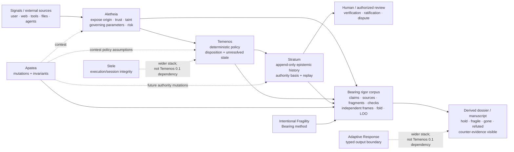
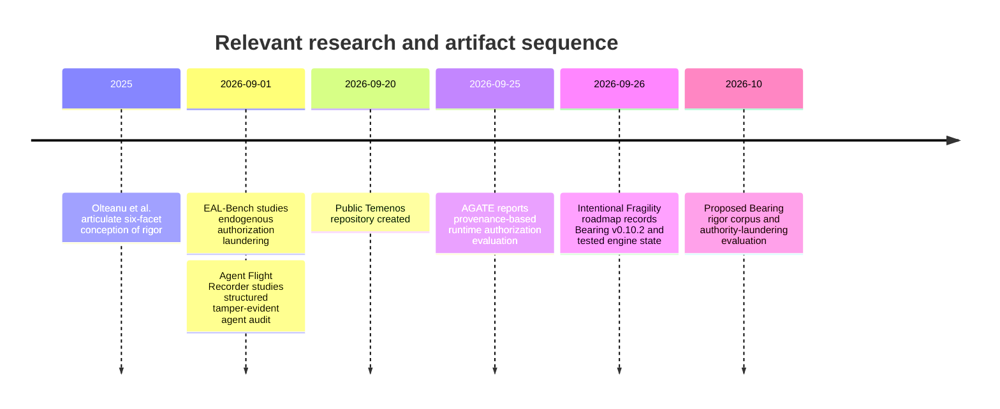

# The Naked Truth: Using the Bearing Engine to Operationalize and Falsify Claims of AI Rigor

## Executive summary

The strongest defensible research claim is **not** that Aletheia, Temenos, Stratum, Apatea, Stele, Adaptive Response, and the Bearing engine “implement Olteanu et al.’s six forms of rigor.” Olteanu et al. explicitly define rigor more broadly than methodological correctness: epistemic, normative, conceptual, methodological, reporting, and interpretative rigor each require not only explicitness but *appropriateness, justification, or support*. A runtime can mechanically expose provenance, authority basis, transitions, checks, and reporting history; it cannot mechanically establish that the underlying knowledge is appropriate, the norm legitimate, the construct valid, or the substantive interpretation sound.

The stronger—and falsifiable—claim is:

> **The stack (Aletheia, Temenos, Stratum, Apatea, Stele, Adaptive Response) operationalizes enforceable conditions that support all six dimensions of rigor, while the Bearing engine can make claims about that operationalization themselves auditable, adversarially testable, and corrigible.**

The evidence for that claim is already substantial. Stratum implements a typed distinction between claims and checked evidence, derives state by folding an append-only history, keeps `authoritative_verified` separate from `authoritative_axiomatic`, fails closed when authoritative projections lack backing, and explicitly disclaims correctness as something its provenance contract can prove. Aletheia separately represents origin, trust class, carried taint, governing parameters, and effect capability, and explicitly says that trust concerns authority to govern action rather than factual correctness; its classifier is separated from its policy decision. Temenos composes Aletheia with deterministic policy and Stratum while preserving checked-versus-cited evidence and surfacing persistence failures as unresolved state. Apatea already adversarially searches representation changes under explicit invariants rather than relying on a fixed attack list.

The **Intentional Fragility Bearing engine is the missing metascientific layer**. It does not store verdicts. It derives a claim’s bearing from an append-only argument ledger, counts independent supporting frames rather than raw evidence quantity, makes unrun checks count zero, preserves contradiction without silently subtracting it, computes leave-one-frame-out sensitivity, and warns when a formally valid corpus flatters itself through ungrounded, check-lifted, unchallenged, or dependency-entangled claims. This is well suited to testing whether the “operationalization of rigor” thesis survives changes in representation, evidence frame, system component, and external literature.

The resulting research design should maintain two separate state machines:
$$

\boxed{\text{Bearing robustness} \neq \text{runtime authority}}

$$
A Bearing claim may be `robust`, `fragile`, `gone`, or explicitly `refuted`. That describes **argument support across evidence frames**. A Stratum record may be narrative, provisional, `authoritative_verified`, or `authoritative_axiomatic`. That describes the **basis under which information is allowed to govern runtime state**. Neither means “true.”

This distinction should become the conceptual center of the paper:
$$

\boxed{
\text{Claim}
\neq
\text{Evidence}
\neq
\text{Authority}
\neq
\text{State}
\neq
\text{Truth}
}

$$
The stack's central research contribution is better described as **epistemic condition preservation** or **authority integrity** than generic provenance. Aletheia currently exposes a meaningful subset of the conditions relevant to authority—origin, trust, taint, governing parameters, and risk factors—but the more general “unconcealment” representation discussed in the paper would be a proposed extension, not an implemented feature. Temenos then governs what follows from those disclosed conditions; Stratum preserves how authority arose; Apatea contests invariants; Bearing tests whether the research claims made about the system survive independent evidence and adversarial removal.

This is also well differentiated from the closest 2026 work. AGATE already combines runtime authorization and data provenance, parameter-bound grants, deterministic judgment, and replayable evidence; its evaluation reports 153 exercised attack-chain records, a parameter-rewriting bypass, utility costs, and perfect live/replay agreement for 63 scenarios on each of two evaluated platforms. EAL-Bench independently shows why persistent state must be treated as an authorization surface: false authority reached 50.2% in one evaluated condition, and executors acted on already-formed false authority in 98.6% of matched trials. Agent Flight Recorder establishes a strong neighboring result for tamper-evident, semantically structured forensic histories. The novel target here is narrower: **whether the epistemically relevant conditions under which information becomes authoritative remain unconcealed, distinguishable, and reconstructible across transformations—and whether claims about that property themselves survive adversarial scrutiny.**

The experimental centerpiece should therefore be **authority-laundering under epistemic-condition mutation**, not prompt-injection detection accuracy. The central falsifiable invariant is:
$$

\Delta A_g(x) > 0
\Rightarrow
\exists T_{\text{authorized}}

$$
and, for axiomatic authority:
$$

A_{\text{axiomatic}}
\not\xrightarrow{\text{persistence, paraphrase, consensus}}
A_{\text{verified}}

$$
The system need not discover universal truth. It must not allow its reason for treating something as authoritative to become concealed.

## Evidence base and artifact inventory

The inventory below distinguishes **implemented**, **observed/documented**, and **proposed** properties. That distinction is essential because some of the conceptual architecture is ahead of current integration.

| Artifact                             | What is implemented now                                                                                                                                                                                                                                                                                                         | What remains proposed or outside its current perimeter                                                                                                                                                                                   | Rigor significance                                                                                                                                        |
| ------------------------------------ | ------------------------------------------------------------------------------------------------------------------------------------------------------------------------------------------------------------------------------------------------------------------------------------------------------------------------------- | ---------------------------------------------------------------------------------------------------------------------------------------------------------------------------------------------------------------------------------------- | --------------------------------------------------------------------------------------------------------------------------------------------------------- |
| **Bearing / Intentional Fragility**  | Typed `Claim`, `Image`, `Fragment`, `Check`, `Source` nodes; append-only argument ledger; `supports`, `tested-by`, `derives-from`, `contradicts`; pure deterministic fold; `robust/fragile/gone/refuted`; leave-one-out; check outcomes; frame provenance validation; honesty audit; derived book/surfaces; Python/JS parity.   | Automatic extraction/generation of claims from repositories is **not** implemented. Roadmap still lists `bearing new ...` helpers and engine split/publication work as open. The rigor-specific corpus proposed here does not yet exist. | Meta-evaluation layer: makes the paper's claims themselves subject to evidence breadth, challenge, retraction, and leave-one-frame-out tests.             |
| **Aletheia**                         | Explicit origin/trust classes; carried taint rather than inferred taint; allowed effects by source; governing-parameter extraction; injection-risk factors; classifier/enforcer separation; shadow/enforce policy; Python/TypeScript parity infrastructure.                                                                     | The generalized disclosure vector \(\Lambda^*\) proposed below—derivation lineage, evidence relation, unresolved assumptions, authority basis/history—is not yet a single Aletheia object.                                               | Strong support for epistemic/conceptual rigor through explicit provenance and category separation; candidate substrate for “unconcealment.”               |
| **Apatea**                           | Transformation algebra over Unicode adjacency, invisibles, normalization, guarded case changes, prose→JSON/YAML/array/value-shape transformations; invariants for monotonicity, extent stability, determinism; vulnerable/fixed/live targets.                                                                                   | Provenance, temporal, lifecycle, multi-agent/topological, and authority-state transformations proposed here are not in the current algebra.                                                                                              | Methodological rigor through adversarial falsification; particularly valuable because “meaning preserving” is itself treated as a claim requiring guards. |
| **Stratum**                          | Disjoint claim/evidence fields; checked-versus-cited evidence; append-only events; status fold by logical sequence; replay; legal transition system; distinct verified/axiomatic/provisional/narrative authority; invalidation/review derivation; fail-closed incomplete projection; reported 16-invariant reference semantics. | Recursive authority-registry/PKI integration and some broader governance extensions are research-agenda items. Stratum explicitly does not prove evidence adequacy or substantive correctness.                                           | Strongest current operationalization of conceptual, epistemic, methodological, and reporting constraints.                                                 |
| **Temenos — conceptual system**      | Architecture separates signal → Aletheia → deterministic policy → Stratum → human review, with Apatea out-of-band.                                                                                                                                                                                                              | Full composition with Stele and Adaptive Response is a wider-stack goal rather than current Temenos 0.1 runtime behavior.                                                                                                                | Provides the governance transition between disclosure and durable state.                                                                                  |
| **`mazze93/temenos` implementation** | `Signal`, `GateResult`, `Verdict`, `AuditReport`; Aletheia adapter; deterministic disposition; Stratum client; Apatea audit; unresolved ledger-write failures; evaluation rubric.                                                                                                                                               | A Temenos `Verdict` written to Stratum is born `asserted`, not automatically verified or axiomatic. Full runtime authority-transition enforcement therefore remains a separate layer/experiment.                                         | Important negative result: deterministic policy and persistence do not themselves equal epistemic verification.                                           |
| **Stele**                            | Harness-level integrity controller; deterministic tripwires; monotonic degradation/lockout; governed instruction compilation; hash-chained audit trail, according to its implementation documentation.                                                                                                                          | Not a Temenos 0.1 runtime dependency. A tested adapter/compositional argument is still required.                                                                                                                                         | Candidate execution-integrity boundary; useful for authority-sink containment rather than epistemic truth.                                                |
| **Adaptive Response**                | Forced structured model output through runtime-generated schema; Zod validation; one bounded repair pass; typed uncertainty/risk/assumption fields; HTTP/MCP interfaces.                                                                                                                                                        | Not a Temenos 0.1 dependency; schema validity does not establish semantic validity.                                                                                                                                                      | Candidate reporting/output constraint; must be tested against “cleanly structured falsehood” rather than assumed to improve rigor.                        |

One artifact-level discrepancy is itself a useful reporting-rigor test. The GitHub repository metadata currently describes `Temenos` as binding *`Aletheia`*, `Apatea`, `Stratum`, `Stele`, and `Adaptive Response` into one control plane. The repository `README` is more constrained: `Stele` and `Adaptive Response` belong to the wider integrity stack but are **not runtime dependencies of Temenos 0.1**, and future integration is not to be claimed until code, tests, and an architecture decision record establish it. Under Temenos's own declared authority ordering—schemas, policy, tests, architecture decisions, then explanatory material—the conservative `README`/code interpretation should govern the paper.

The same discipline applies to Bearing. The engine currently **does not generate scientific claims autonomously**. It scaffolds a corpus, stores typed claim/evidence objects, validates the argument graph, runs checks, and derives bearings. The current scaffold demonstrates exactly that shape, while the roadmap still lists convenience claim-generation commands as future work. For this paper, claim extraction from source code and literature should therefore be a **human-supervised ingestion stage**, not attributed to the `Bearing engine`.

The external theoretical frame is equally important. Olteanu et al. describe six facets of rigor and argue against reducing rigor to methodological competence alone. A useful operational mapping is therefore:

| Olteanu dimension | Mechanically supportable condition in this stack | What remains outside the mechanical guarantee |
|---|---|---|
| **Epistemic** | Explicit provenance, background source, evidence status, assumptions/trust dependencies, transformation lineage | Whether the selected knowledge is appropriate, complete, or well justified |
| **Normative** | Explicit policy, ratifier/trust root, axiomatic authority class, policy version | Whether the norm or value is ethically/socially appropriate or legitimate |
| **Conceptual** | Typed distinction among signal, assertion, evidence, verification, authority, state, and report | Whether the construct itself validly captures the phenomenon |
| **Methodological** | Deterministic folds, replay, invariants, parity, adversarial mutation, predeclared metrics | Whether the chosen test genuinely answers the research question |
| **Reporting** | Append-only histories, derived projections, explicit unresolved state, source dossier, negative evidence | Whether the trace is complete and whether omitted context changes interpretation |
| **Interpretative** | No silent promotion from assertion/check to truth; contradictions remain visible; argument bearing derived separately | Whether the substantive conclusion really follows from the total evidence |

This is the key language adjustment I would make throughout the paper:

> **The architecture operationalizes enforceable conditions of rigor; it does not mechanically instantiate the substantive adequacy of all six facets.**

Aligning with Olteanu et al.'s broader conception while respecting Stratum's own explicit perimeter. 

AGATE already demonstrates that explicit authorization provenance, data provenance, deterministic runtime judgment, consumable grants, and replayable grounds can be practically combined.  EAL-Bench shows that persistent memory can manufacture apparent authority without an adversarial injection and that event-sourced/source-backed mitigations trade safety against legitimate authorization availability. Agent Flight Recorder shows the neighboring value of structured, tamper-evident agent histories. W3C PROV provides a mature interoperability vocabulary around `Entity`, `Activity`, `Agent`, derivation, generation, attribution, usage, association, and delegation that can be reused instead of inventing provenance interchange from scratch. 

The architecture and research lineage are therefore best understood as follows:

A useful research timeline is:

The dates for the public research are taken from the primary publication records; the Temenos repository metadata records its September 20 creation, and the Intentional Fragility roadmap identifies version 0.10.2 on September 26.
## Bearing-engine design for executable rigor

The Bearing engine should be used as a **claim laboratory**, not as the runtime authority engine. That preserves the distinction between “how strongly does this research claim stand?” and “what is an agent allowed to do?”

The proposed research corpus should use evidence frames that reflect genuinely different ways of knowing:

| Frame | Evidence admitted | Independence rule |
|---|---|---|
| `implementation` | Code paths, schemas, tests, runtime traces | Multiple files from one component remain one implementation neighborhood |
| `formal-semantics` | Transition proofs, invariant derivations, independent implementation parity | Must not merely restate implementation comments |
| `external-literature` | Olteanu, AGATE, EAL-Bench, W3C, OWASP, NIST, other primary papers | Same paper cannot create several independent frames |
| `adversarial-evaluation` | Mutation suite, threat scenarios, negative tests | Generated from predeclared operators and observable oracles |
| `replication` | Clean-room replay or independently implemented reducer/evaluator | Must not share the tested implementation's decision logic |
| `normative-review` | Independent human review of policies/constructs/value commitments | Author's own judgment should be provenance, not automatically an independent evidentiary frame |

That last restriction follows the Bearing engine's own existing discipline. Intentional Fragility already supports non-counting frames and its roadmap explicitly records the decision that the author's own writing should not inflate the robustness of the book's claims; the audit also warns about derived-only support and hidden dependencies. fileciteturn15file0L2-L2 fileciteturn18file0L2-L2 fileciteturn37file0L2-L2

**The current Bearing object model.** Let \(C\) be claims, \(S\) sources, \(F\) fragments, and \(K\) executable checks. The implementation permits evidence relations:

\[
R \in
\{
supports,\ tested\text{-}by,\ derives\text{-}from,\ contradicts
\}
\]

with source-type constraints enforced by ledger validation. Frames are declared and disjoint at the tag level, and a claim cannot serve as evidence for itself. fileciteturn15file0L2-L2 fileciteturn17file0L2-L2

A useful paper-specific evidence object is:

\[
e =
(
id,\ kind,\ source,\ relation,\ frame,\ provenance,\ check,\ outcome
)
\]

where the last two fields may be null. This should map onto existing Bearing Source/Fragment/Check nodes rather than require a replacement data model.

For claim \(c\) at ledger read-point \(t\), Bearing already computes:

\[
B_t(c)
=
Fold_B(L_{\leq t},F_{\text{active}},\pi)
\]

with:

\[
\rho_t(c)
=
\left|
\{\text{distinct active supporting frames}\}
\right|
\]

and the current policy:

\[
tier(c)=
\begin{cases}
refuted & \text{if explicit refute event exists}\\
robust & \rho \ge 2\\
fragile & \rho=1\\
gone & \rho=0
\end{cases}
\]

A `tested-by` edge contributes only after its most recent `run-check` outcome is `held`; contradiction remains visible rather than being silently deducted from the score. fileciteturn16file0L2-L2

This should **not** be interpreted as:

\[
robust(c)\Rightarrow true(c)
\]

Two correlated or mistaken frames can support a false claim. The threshold of two is an explicit Bearing policy, not an epistemic theorem. The paper should say so prominently.

**Runtime authority is a separate type system.** Stratum's semantics instead give us:

\[
A(x) =
(g,b)
\]

where \(g\) represents governing capability and \(b\) represents the basis under which that capability was obtained.

A minimal projection is:

| Stratum authority state | Governing? | Basis |
|---|---:|---|
| `narrative` | no | assertion/prose |
| `authoritative_provisional` | limited/not canonical | pending evidence or review |
| `authoritative_verified` | yes | checked evidence + legal verification transition |
| `authoritative_axiomatic` | yes | explicit trust root / ratification |

Stratum deliberately keeps the final two non-equivalent: axiomatic authority is not “more verified” than verified authority, and verified authority is not “more legitimate” than an explicit policy axiom. They answer different questions. 

The existing transition system is:

$$
asserted
\rightarrow
\{ratified,disputed\}

$$
$$
pending\_evidence
\rightarrow
\{validated,rejected,disputed\}
 $$
$$

validated
\rightarrow
\{contradicted,superseded\}
$$
$$contradic