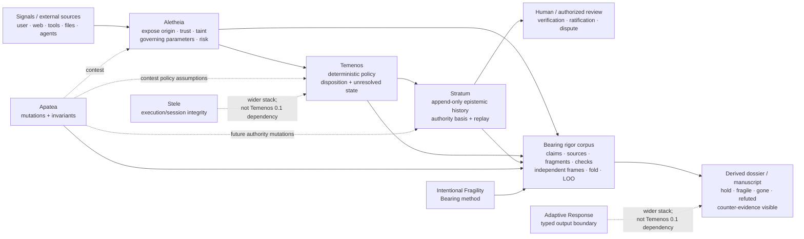
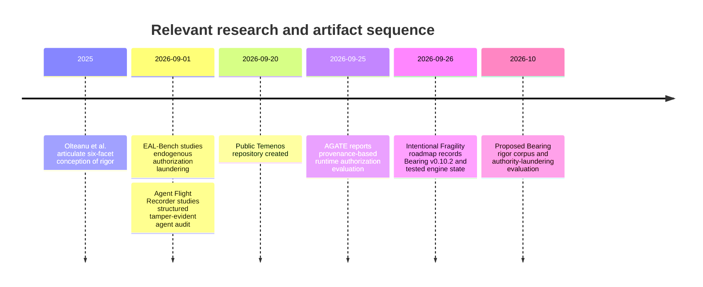

| **`mazze93/temenos` implementation** | `Signal`, `GateResult`, `Verdict`, `AuditReport`; Aletheia adapter; deterministic disposition; Stratum client; Apatea audit; unresolved ledger-write failures; evaluation rubric.                                                                                                                                               | A Temenos `Verdict` written to Stratum is born `asserted`, not automatically verified or axiomatic. Full runtime authority-transition enforcement therefore remains a separate layer/experiment.                                         | Important negative result: deterministic policy and persistence do not themselves equal epistemic verification.                                           |
| **Stele**                            | Harness-level integrity controller; deterministic tripwires; monotonic degradation/lockout; governed instruction compilation; hash-chained audit trail, according to its implementation documentation.                                                                                                                          | Not a Temenos 0.1 runtime dependency. A tested adapter/compositional argument is still required.                                                                                                                                         | Candidate execution-integrity boundary; useful for authority-sink containment rather than epistemic truth.                                                |
| **Adaptive Response**                | Forced structured model output through runtime-generated schema; Zod validation; one bounded repair pass; typed uncertainty/risk/assumption fields; HTTP/MCP interfaces.                                                                                                                                                        | Not a Temenos 0.1 dependency; schema validity does not establish semantic validity.                                                                                                                                                      | Candidate reporting/output constraint; must be tested against “cleanly structured falsehood” rather than assumed to improve rigor.                        |

One artifact-level discrepancy is itself a useful reporting-rigor test. The GitHub repository metadata currently describes `Temenos` as binding *`Aletheia`*, `Apatea`, `Stratum`, `Stele`, and `Adaptive Response` into one control plane. The repository `README` is more constrained: `Stele` and `Adaptive Response` belong to the wider integrity stack but are **not runtime dependencies of Temenos 0.1**, and future integration is not to be claimed until code, tests, and an architecture decision record establish it. Under Temenos's own declared authority ordering—schemas, policy, tests, architecture decisions, then explanatory material—the conservative `README`/code interpretation should govern the paper.

The same discipline applies to Bearing. The engine currently **does not generate scientific claims autonomously**. It scaffolds a corpus, stores typed claim/evidence objects, validates the argument graph, runs checks, and derives bearings. The current scaffold demonstrates exactly that shape, while the roadmap still lists convenience claim-generation commands as future work. For this paper, claim extraction from source code and literature should therefore be a **human-supervised ingestion stage**, not attributed to the `Bearing engine`.

The external theoretical frame is equally important. Olteanu et al. describe six facets of rigor and argue against reducing rigor to methodological competence alone. A useful operational mapping is therefore:

| Olteanu dimension | Mechanically supportable condition in this stack | What remains outside the mechanical guarantee |
|---|---|---|
| **Epistemic** | Explicit provenance, background source, evidence status, assumptions/trust dependencies, transformation lineage | Whether the selected knowledge is appropriate, complete, or well justified |
| **Normative** | Explicit policy, ratifier/trust root, axiomatic authority class, policy version | Whether the norm or value is ethically/socially appropriate or legitimate |
| **Conceptual** | Typed distinction among signal, assertion, evidence, verification, authority, state, and report | Whether the construct itself validly captures the phenomenon |
| **Methodological** | Deterministic folds, replay, invariants, parity, adversarial mutation, predeclared metrics | Whether the chosen test genuinely answers the research question |
| **Reporting** | Append-only histories, derived projections, explicit unresolved state, source dossier, negative evidence | Whether the trace is complete and whether omitted context changes interpretation |
| **Interpretative** | No silent promotion from assertion/check to truth; contradictions remain visible; argument bearing derived separately | Whether the substantive conclusion really follows from the total evidence |

This is the key language adjustment I would make throughout the paper:

> **The architecture operationalizes enforceable conditions of rigor; it does not mechanically instantiate the substantive adequacy of all six facets.**

Aligning with Olteanu et al.'s broader conception while respecting Stratum's own explicit perimeter. 

AGATE already demonstrates that explicit authorization provenance, data provenance, deterministic runtime judgment, consumable grants, and replayable grounds can be practically combined.  EAL-Bench shows that persistent memory can manufacture apparent authority without an adversarial injection and that event-sourced/source-backed mitigations trade safety against legitimate authorization availability. Agent Flight Recorder shows the neighboring value of structured, tamper-evident agent histories. W3C PROV provides a mature interoperability vocabulary around `Entity`, `Activity`, `Agent`, derivation, generation, attribution, usage, association, and delegation that can be reused instead of inventing provenance interchange from scratch. 

The architecture and research lineage are therefore best understood as follows:

A useful research timeline is:

The dates for the public research are taken from the primary publication records; the Temenos repository metadata records its September 20 creation, and the Intentional Fragility roadmap identifies version 0.10.2 on September 26.
## Bearing-engine design for executable rigor

The Bearing engine should be used as a **claim laboratory**, not as the runtime authority engine. That preserves the distinction between “how strongly does this research claim stand?” and “what is an agent allowed to do?”

The proposed research corpus should use evidence frames that reflect genuinely different ways of knowing:

| Frame | Evidence admitted | Independence rule |
|---|---|---|
| `implementation` | Code paths, schemas, tests, runtime traces | Multiple files from one component remain one implementation neighborhood |
| `formal-semantics` | Transition proofs, invariant derivations, independent implementation parity | Must not merely restate implementation comments |
| `external-literature` | Olteanu, AGATE, EAL-Bench, W3C, OWASP, NIST, other primary papers | Same paper cannot create several independent frames |
| `adversarial-evaluation` | Mutation suite, threat scenarios, negative tests | Generated from predeclared operators and observable oracles |
| `replication` | Clean-room replay or independently implemented reducer/evaluator | Must not share the tested implementation's decision logic |
| `normative-review` | Independent human review of policies/constructs/value commitments | Author's own judgment should be provenance, not automatically an independent evidentiary frame |

That last restriction follows the Bearing engine's own existing discipline. Intentional Fragility already supports non-counting frames and its roadmap explicitly records the decision that the author's own writing should not inflate the robustness of the book's claims; the audit also warns about derived-only support and hidden dependencies. 

**The current Bearing object model.** Let \(C\) be claims, \(S\) sources, \(F\) fragments, and \(K\) executable checks. The implementation permits evidence relations:

\[
R \in
\{
supports,\ tested\text{-}by,\ derives\text{-}from,\ contradicts
\}
\]

with source-type constraints enforced by ledger validation. Frames are declared and disjoint at the tag level, and a claim cannot serve as evidence for itself. 

A useful paper-specific evidence object is:

\[
e =
(
id,\ kind,\ source,\ relation,\ frame,\ provenance,\ check,\ outcome
)
\]

where the last two fields may be null. This should map onto existing Bearing Source/Fragment/Check nodes rather than require a replacement data model.

For claim \(c\) at ledger read-point \(t\), Bearing already computes:

\[
B_t(c)
=
Fold_B(L_{\leq t},F_{\text{active}},\pi)
\]

with:

\[
\rho_t(c)
=
\left|
\{\text{distinct active supporting frames}\}
\right|
\]

and the current policy:

\[
tier(c)=
\begin{cases}
refuted & \text{if explicit refute event exists}\\
robust & \rho \ge 2\\
fragile & \rho=1\\
gone & \rho=0
\end{cases}
\]

A `tested-by` edge contributes only after its most recent `run-check` outcome is `held`; contradiction remains visible rather than being silently deducted from the score. 

This should **not** be interpreted as:

\[
robust(c)\Rightarrow true(c)
\]

Two correlated or mistaken frames can support a false claim. The threshold of two is an explicit Bearing policy, not an epistemic theorem. The paper should say so prominently.

**Runtime authority is a separate type system.** Stratum's semantics instead give us:

\[
A(x) =
(g,b)
\]

where \(g\) represents governing capability and \(b\) represents the basis under which that capability was obtained.

A minimal projection is:

| Stratum authority state | Governing? | Basis |
|---|---:|---|
| `narrative` | no | assertion/prose |
